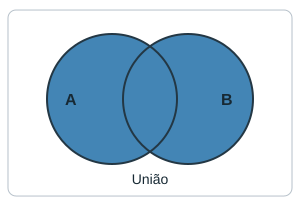
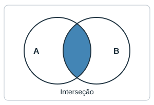
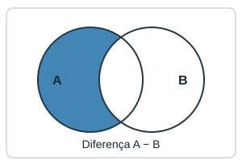
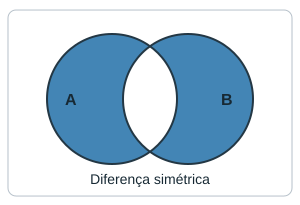

# Modelagem Matemática — UrbanInventory

## 1. Introdução

O UrbanInventory é um projeto voltado para a organização do patrimônio público. Ele trabalha com informações sobre ativos, locais, órgãos responsáveis, jurisdições e usuários que podem acessar o sistema.

Na parte de Matemática Discreta, usamos conjuntos, relações binárias, funções e matrizes de pertencimento para representar essas informações. Esses conceitos ajudam a fazer consultas, relacionar os dados e verificar se as associações estão corretas.

A modelagem também serve de base para o controle de acesso por papéis, conhecido como RBAC. A proposta é deixar a parte matemática separada das funções de cadastro e das demais regras do sistema.

## 2. Definição dos conjuntos

Primeiro, representamos as principais informações do UrbanInventory por meio de conjuntos:

- **At:** conjunto dos ativos públicos.
- **L:** conjunto dos locais.
- **J:** conjunto das jurisdições.
- **U:** conjunto dos usuários.
- **O:** conjunto dos órgãos.
- **R:** conjunto dos papéis dos usuários.
- **P:** conjunto das permissões.

Um exemplo simples seria:

```text
At = {A1, A2, A3, A4}
L  = {L1, L2, L3}
J  = {Norte, Sul, Centro}
U  = {U1, U2}
O  = {O1, O2}
R  = {Fiscal, Administrador}
P  = {consultar, criar, atualizar, excluir}
```

Aqui, `A1`, `A2` e os demais códigos são identificadores usados nos exemplos. Na aplicação, eles representam os itens cadastrados.

O uso de conjuntos facilita as consultas porque cada elemento aparece uma única vez dentro do mesmo conjunto. No Python, utilizamos principalmente o tipo `set` para trabalhar com eles.

## 3. Operações com conjuntos

Para entender as operações, vamos considerar dois grupos de ativos:

```text
A = {A1, A2, A3}      ativos da Zona Norte
B = {A2, A3, A4}      ativos com manutenção pendente
```

Neste exemplo, `A` e `B` são grupos de consulta, e `At` continua representando o conjunto geral de ativos.

### 3.1 União

A união junta todos os ativos que aparecem em pelo menos um dos grupos, sem repetir os elementos.

**A ∪ B = {A1, A2, A3, A4}**

No código, essa operação é feita pela função `uniao()` com o operador `|`. Ela pode ser usada quando precisamos reunir ativos de duas consultas.

### 3.2 Interseção

A interseção mostra apenas os ativos que estão nos dois grupos ao mesmo tempo.

**A ∩ B = {A2, A3}**

Nesse caso, encontramos os ativos da Zona Norte que também estão com manutenção pendente. A função `intersecao()` usa o operador `&`.

### 3.3 Diferença

A diferença retorna os elementos do primeiro conjunto que não estão no segundo.

**A − B = {A1}**

Assim, podemos encontrar os ativos da Zona Norte que não estão na lista de manutenção pendente. A função `diferenca()` usa o operador `-`.

### 3.4 Diferença simétrica

A diferença simétrica reúne os elementos que aparecem em apenas um dos dois conjuntos.

**A Δ B = {A1, A4}**

A função `diferenca_simetrica()` faz essa operação com `^`.

### 3.5 Conjunto vazio, subconjuntos e conjuntos disjuntos

Também usamos algumas verificações para comparar conjuntos:

- Um **conjunto vazio** não possui elementos. A função `eh_vazio()` verifica isso.
- Um conjunto é **subconjunto** de outro quando todos os seus elementos também aparecem no segundo. A função `eh_subconjunto()` faz essa verificação com `<=`.
- Dois conjuntos são **disjuntos** quando não têm nenhum elemento em comum. A função `sao_disjuntos()` utiliza `isdisjoint()`.

Por exemplo, `{A1}` é subconjunto de `{A1, A2}`. Já `{A1}` e `{A3}` são disjuntos, pois não possuem elementos em comum.

### 3.6 Diagramas de Venn

Os diagramas de Venn ajudam a visualizar as operações entre dois conjuntos. Nas figuras abaixo, a parte azul representa o resultado de cada operação.

| União (A ∪ B) | Interseção (A ∩ B) |
|:---:|:---:|
|  |  |

| Diferença (A − B) | Diferença simétrica (A Δ B) |
|:---:|:---:|
|  |  |

Nos conjuntos usados como exemplo, `A2` e `A3` ficam na parte em comum dos círculos. `A1` fica apenas em A, enquanto `A4` fica apenas em B.

## 4. Relações binárias

As relações binárias representam ligações entre elementos de dois conjuntos. No UrbanInventory, elas são importantes para mostrar, por exemplo, qual órgão administra um ativo e qual papel pertence a determinado usuário.

As principais relações do projeto são:

- Usuário → Órgão.
- Órgão → Ativo.
- Usuário → Papel.
- Papel → Permissão.

Também usamos o mapeamento Ativo → Jurisdição, explicado na próxima seção.

Cada associação pode ser representada por um **par ordenado**, que no Python é uma tupla. Um conjunto de pares representa várias associações:

```text
R1 = {(U1, O1), (U2, O2)}
R2 = {(O1, A1), (O1, A2), (O2, A3)}
```

A relação `R1` indica o órgão de cada usuário. Já `R2` mostra os ativos relacionados a cada órgão. Em notação matemática, podemos escrever `R1 ⊆ U × O` e `R2 ⊆ O × At`.

A função `criar_relacao()` monta um par ordenado. As funções `consultar_relacoes()` e `imagem()` procuram os elementos associados a uma origem informada.

### 4.1 Composição de relações

A composição permite descobrir uma relação indireta a partir de duas relações que possuem um elemento intermediário em comum.

Por exemplo:

```text
U1 → O1
O1 → A1
O1 → A2
```

Ao compor essas relações, encontramos:

```text
U1 → A1
U1 → A2
```

Isso significa que podemos consultar os ativos associados ao usuário `U1` por meio do órgão `O1`.

No código, a função `composicao_indexada()` faz essa operação. Ela primeiro organiza os destinos da segunda relação em um dicionário e depois procura as correspondências da primeira. Dessa forma, não precisa comparar todos os pares das duas relações entre si.

## 5. Funções e mapeamentos

Uma função matemática relaciona cada elemento de um domínio a **exatamente um** elemento do contradomínio.

No UrbanInventory, podemos usar esse conceito para representar a jurisdição dos ativos:

**f: At → J**

Isso quer dizer que cada ativo do conjunto `At` deve estar ligado a uma jurisdição do conjunto `J`.

Exemplo:

```text
f(A1) = Norte
f(A2) = Norte
f(A3) = Sul
```

Dois ativos podem ter a mesma jurisdição. O que não pode acontecer, para esse mapeamento ser uma função, é um único ativo possuir duas jurisdições diferentes ou ficar sem nenhuma associação.

### 5.1 Consulta e validação de jurisdição

No arquivo `nucleo_mat.py`, usamos duas funções para trabalhar com o mapeamento armazenado em dicionário:

- `consultar_jurisdicao(mapeamento, ativo)`: retorna a jurisdição cadastrada para o ativo ou `None` se ele não estiver no dicionário.
- `validar_mapeamento(mapeamento, ativos, jurisdicoes)`: verifica se todos os ativos informados possuem uma associação e se o valor de cada associação pertence às jurisdições permitidas.

Exemplo:

```python
mapeamento = {"A1": "Norte", "A2": "Sul"}
ativos = {"A1", "A2"}
jurisdicoes = {"Norte", "Sul"}

# validar_mapeamento(mapeamento, ativos, jurisdicoes) retorna True
```

Essa validação confere os ativos recebidos como parâmetro. Ela não identifica automaticamente chaves extras que estejam no dicionário, mas não estejam no conjunto de ativos informado. Como o dicionário guarda um único valor por chave, usamos relações com pares ordenados quando precisamos verificar a possibilidade de um ativo aparecer com duas jurisdições diferentes.

### 5.2 Verificação de função matemática

A função `eh_funcao(relacao, dominio)` trabalha com uma relação formada por pares ordenados. Ela verifica:

1. Se todos os elementos do domínio possuem uma imagem.
2. Se algum elemento possui duas ou mais imagens diferentes.
3. Se existe alguma origem na relação fora do domínio informado.

Quando a relação atende a essas condições, o retorno é `(True, set())`. Caso contrário, a função retorna `False` e um conjunto com os elementos que apresentam problemas.

Por exemplo:

```python
relacao = {("A1", "Norte"), ("A1", "Sul")}
dominio = {"A1"}

# eh_funcao(relacao, dominio) retorna (False, {"A1"})
```

Nesse caso, `A1` aparece ligado a duas jurisdições diferentes, então a relação não representa uma função. Outro caso inválido é quando um ativo do domínio fica sem imagem.

A função `eh_funcao()` não recebe o conjunto de jurisdições válidas. Por isso, a conferência de valores permitidos é feita separadamente pela validação do mapeamento.

## 6. Modelagem matemática do RBAC

RBAC significa *Role-Based Access Control*, ou controle de acesso baseado em papéis. Nesse modelo, as permissões de cada usuário dependem dos papéis que ele possui.

Podemos representar as ligações assim:

```text
Usuário → Papel → Permissão
```

Por exemplo:

```text
Fiscal = {consultar, atualizar}
Administrador = {consultar, criar, atualizar, excluir}
```

Se um usuário possuir os dois papéis, podemos usar a união para reunir suas permissões:

**Fiscal ∪ Administrador = {consultar, criar, atualizar, excluir}**

De forma matemática, usamos duas relações:

- **UR ⊆ U × R:** liga cada usuário aos seus papéis.
- **RP ⊆ R × P:** liga cada papel às permissões correspondentes.

A composição de `UR` com `RP` permite encontrar as permissões associadas a um usuário. Para autorizar uma ação, o sistema precisa verificar se a permissão solicitada está entre as permissões desse usuário e aplicar as demais regras de acesso que forem necessárias.

Essa é a ideia matemática do RBAC. A verificação de acesso feita pela aplicação pertence à camada de serviços, que utiliza os dados e as operações necessárias para aplicar as regras.

## 7. Matriz de pertencimento

A matriz de pertencimento é uma forma de mostrar quais ativos estão ligados a cada jurisdição. As **linhas** representam as jurisdições, as **colunas** representam os ativos e os valores da matriz são `0` ou `1`.

- **1:** o ativo pertence àquela jurisdição.
- **0:** o ativo não pertence àquela jurisdição.

Um exemplo é:

| Jurisdição | A1 | A2 | A3 | A4 |
|---|:---:|:---:|:---:|:---:|
| Norte | 1 | 1 | 0 | 0 |
| Sul | 0 | 0 | 1 | 0 |
| Centro | 0 | 0 | 0 | 1 |

A matriz numérica correspondente é:

```text
M = [
    [1, 1, 0, 0],
    [0, 0, 1, 0],
    [0, 0, 0, 1]
]
```

Podemos escrever essa regra como **M[i][j] = 1** quando o ativo da coluna `j` pertence à jurisdição da linha `i`, e **M[i][j] = 0** caso contrário.

### 7.1 Como a matriz é construída no código

A função atual é `matriz_pertencimento(conjuntos, colunas)`. Ela recebe um dicionário que relaciona cada jurisdição ao conjunto de seus ativos e uma lista com a ordem das colunas.

```python
conjuntos = {
    "Norte": {"A1", "A2"},
    "Sul": {"A3"},
    "Centro": {"A4"}
}

colunas = ["A1", "A2", "A3", "A4"]

linhas, ativos, matriz = matriz_pertencimento(conjuntos, colunas)
```

Nesse exemplo, o retorno é formado por três partes: `linhas`, `ativos` (a lista de colunas) e `matriz`. A função `formatar_matriz(linhas, ativos, matriz)` organiza essas informações em texto para exibição.

A matriz mostra as associações que foram informadas. Ela não faz a validação sozinha: se um ativo aparecer em duas jurisdições, a coluna dele poderá ter dois valores `1`. Se não aparecer em nenhuma das jurisdições apresentadas, a coluna terá apenas valores `0`.

## 8. Estruturas de dados utilizadas

Para montar o núcleo matemático, utilizamos estruturas básicas do Python:

| Estrutura | Como utilizamos |
|---|---|
| `set` | Guardar conjuntos de ativos e permissões, sem elementos repetidos. |
| `tuple` | Representar os pares ordenados das relações. |
| `dict` | Guardar os mapeamentos e organizar os índices das relações. |
| `list` | Organizar as colunas, as linhas e os valores da matriz. |

Também usamos estruturas aninhadas. Um exemplo do núcleo é um dicionário em que cada jurisdição possui um conjunto de ativos:

```python
conjuntos = {
    "Norte": {"A1", "A2"},
    "Sul": {"A3"}
}
```

No caso dos dados de usuários, o projeto também pode representar informações com dicionários dentro de outros dicionários, como no modelo proposto pelo professor:

```python
usuarios = {
    "U001": {
        "nome": "João",
        "papel": "Fiscal",
        "jurisdicao": "Norte"
    }
}
```

Os tipos `dict` e `set` utilizam tabelas hash internamente. Isso ajuda nas consultas por chave e na verificação de pertencimento, que aparecem em vários algoritmos do projeto.

## 9. Aplicação da modelagem no UrbanInventory

O núcleo matemático fica na pasta `src/algorithms/`, principalmente no arquivo `nucleo_mat.py`. Nele estão as operações com conjuntos, relações, funções, mapeamentos e matrizes apresentadas neste documento. O projeto também possui `conjuntos.py`, com algumas operações semelhantes.

A ideia da separação em camadas é deixar os algoritmos matemáticos nessa pasta e fazer com que os serviços do sistema cuidem dos cadastros, das consultas e das regras de acesso.

Para verificar as funções, utilizamos testes automatizados com `pytest`, organizados na pasta `tests/`. Foram testadas operações de conjuntos, relações, validações de função e de mapeamento, composição de relações e geração e formatação de matrizes. Também foram incluídos casos em que não existe associação ou algum dado está faltando.

Na execução dos testes, **26 testes passaram**. Isso confirma os resultados dos casos testados, mas não substitui a verificação de toda a aplicação quando os módulos estiverem integrados.

Os detalhes de implementação ficam no documento `05_algoritmos.md`. A análise Big-O, as medições de desempenho e os gráficos são tratados separadamente na documentação de complexidade e nos relatórios do projeto.

## 10. Considerações finais

Com essa modelagem, conseguimos usar os conteúdos de Matemática Discreta em exemplos ligados ao patrimônio público. Os conjuntos ajudam a comparar grupos de ativos, as relações mostram como usuários, órgãos e permissões estão ligados, e as funções permitem verificar as associações com as jurisdições.

A matriz de pertencimento facilita a visualização dessas informações. Além disso, os conceitos de conjuntos e relações dão apoio à organização das permissões no RBAC.

Essas operações formam a base matemática usada pelos algoritmos do UrbanInventory e ajudam a manter as regras do sistema mais organizadas.
